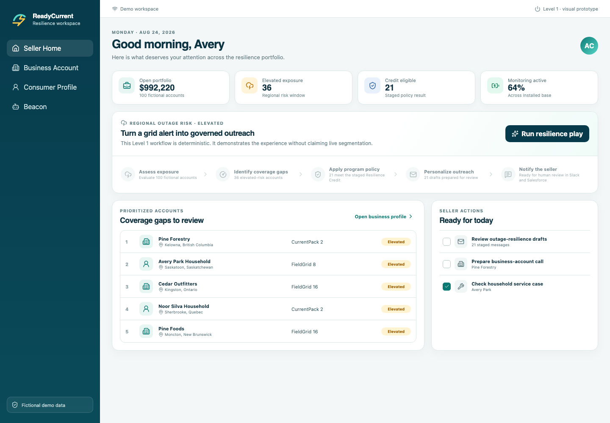

# Agentic Demo Blueprint

A safe, fictional, progressively connected blueprint for demonstrating how a
modern Salesforce experience can move from a polished React prototype to a
human-approved, closed-loop agentic workflow.

The sample company is **ReadyCurrent Technologies**. It sells backup-power
hardware and monitoring plans to households and field-service businesses. When
an outage-risk alert appears, its assistant, **Beacon**, identifies accounts
that may need coverage, checks fictional program eligibility, drafts tailored
outreach, and hands control to a seller before anything is sent.

> This repository is not derived from customer data. Every company, person,
> product, message, image, metric, and identifier was created for this public
> sample.



## Choose your level

| Level | What it proves | Accounts required |
|---|---|---|
| 1. Visual prototype | Story, UI, responsive workflow animation, unified profiles, deterministic agent | None |
| 2. Connected Salesforce demo | Fictional Salesforce records, Apex reads, run and draft writeback, optional Agentforce | Salesforce org |
| 3. Closed-loop agentic demo | Editable Slack review, human approval, instant event, idempotent Salesforce processing | Salesforce + Slack |

Start with [Choose your level](docs/00-choose-your-level.md). Each level stands
on its own; you do not need Slack to learn from the React or Salesforce layers.

The Level 2 package can also be installed beside an existing demo. It creates a
separate **ReadyCurrent** Lightning app, uses namespaced fictional record keys,
and includes an equally scoped cleanup script. See the
[connected Salesforce guide](salesforce/README.md).

## Quick start — Level 1

Prerequisites: Node.js 22 or newer.

```bash
npm install
npm run verify
npm run dev
```

Open the URL printed by Vite. No credentials or cloud services are required.

## What to show

1. **Seller Home:** outage-risk play, pipeline context, and an animated
   segmentation-to-draft workflow.
2. **Business Account:** a unified B2B profile with equipment, subscriptions,
   service signals, and a pre-approved resilience offer.
3. **Consumer Profile:** a household view spanning commerce, service, and
   engagement.
4. **Beacon:** a deterministic assistant with simulated Outlook, Calendar, and
   SharePoint connectors. Toggle tools to show how available context changes
   the response.
5. **Closed loop:** follow the Level 3 guide to review drafts in Slack, approve
   them, and write completion activity back to Salesforce.

## Architecture

```text
Level 1
React UI ── deterministic fictional fixtures
         └─ staged Beacon router + simulated tool toggles

Level 2
React/LWC ── Apex service ── fictional Salesforce records
         └─ optional Agentforce Agent API path

Level 3
Salesforce run + drafts ── Slack List ── human approval
                                   └─ hosted reaction event
                                      └─ Apex REST + idempotent processing
```

Read [Architecture](docs/architecture.md) and
[Truth and simulation](docs/truth-and-simulation.md) before presenting the
connected levels.

The implementation checks performed for this release are recorded in
[Validation evidence](docs/validation-evidence.md). To publish one level as a
smaller project, follow [Extracting components](docs/09-extracting-components.md).

## Repository map

```text
src/                    Level 1 React experience
salesforce/             Level 2 metadata, Apex, LWC, and seed guidance
slack/approval-hosted/  Level 3 hosted event reference
docs/                   End-to-end learning path
scripts/                Deterministic fixtures and public-safety checks
```

## Salesforce environment

The original pattern was developed in a Salesforce demo org, but orgs vary by
edition, release, license, and provisioning. The visual prototype requires no
org. For connected levels, run the documented preflight and verify the exact
features you plan to use.

Useful official references:

- [Choose the right Salesforce org](https://developer.salesforce.com/blogs/2024/05/choose-the-right-salesforce-org-for-the-right-job)
- [Sandbox types and intended uses](https://help.salesforce.com/s/articleView?id=sf.create_test_instance.htm&language=en_US&type=5)
- [Salesforce Multi-Framework GA](https://developer.salesforce.com/blogs/2026/07/build-with-react-on-salesforce-multi-framework-is-now-ga)
- [Developer Edition with Agentforce and Data Cloud](https://help.salesforce.com/s/articleView?id=xcloud.overview_developer_edition_agentforce_datacloud.htm&language=en_US&type=5)
- [Agentforce Agent API](https://developer.salesforce.com/docs/ai/agentforce/references/agent-api)

## Safety

Read [SECURITY.md](SECURITY.md). The Level 3 proof mode must never send to the
fictional addresses shown in the UI. Production outreach requires a separate
review of consent, deliverability, limits, compliance, monitoring, and rollback.

## License

[MIT](LICENSE)
